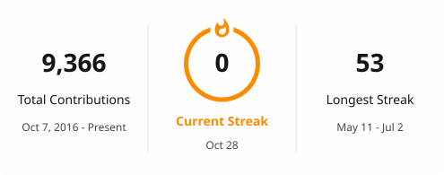

### Hey, I'm Abanob 👋

Software engineer. I like fast queries, boring deploys, and APIs that tell you what went wrong.

- **Now:** building MCP servers and agent tooling, mostly to learn what makes a tool easy for an AI to use
- **Before:** made search fast over 1.2B+ contacts at Surfe (Go, OpenSearch). At Camlist, I built the backend of a pet marketplace app (NestJS) and its Android live-streaming feature (Kotlin)
- **Currently learning:** Kubernetes and Terraform, by taking one of my own projects from Docker Compose to a Terraform-managed cluster
- **Off the clock:** rebuilding a very old game with Claude Code, just for fun

**Usually working with:** Go · TypeScript · NestJS · PostgreSQL · Redis · OpenSearch · Kotlin · Docker · Terraform · AWS / GCP

<picture>
  <source media="(prefers-color-scheme: dark)" srcset="./profile/streak-dark.svg">
  
</picture>

[LinkedIn](https://www.linkedin.com/in/abanob-nageh)
